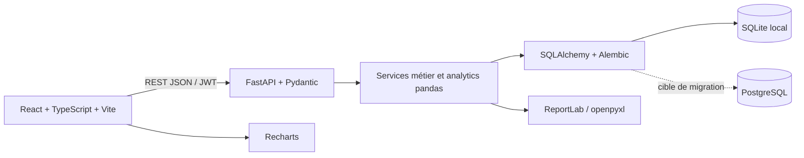
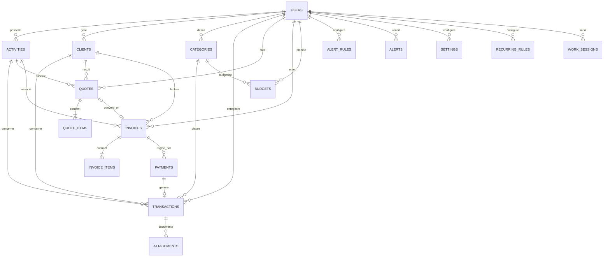

# Architecture FinPilot

## Vue d’ensemble

## Schéma relationnel

## Intégrité et index

- Chaque ligne métier porte `user_id`; les routes vérifient la propriété avant lecture ou modification.
- Clés étrangères avec suppression en cascade pour les enfants et mise à `NULL` pour les affectations facultatives.
- Unicité utilisateur + e-mail client, nom d’activité, nom/type de catégorie, clé de paramètre, numéro de devis/facture. Une facture issue d’un devis garde un `quote_id` unique.
- Index sur e-mail, `user_id`, dates de transaction, activité, client, catégorie, statut et paiements par facture.
- Validations API pour montants positifs, dates cohérentes, taux de remise/TVA et statuts autorisés. Les lignes enfants de devis et facture conservent une copie des montants et désignations pour préserver l’historique documentaire.
- SQLite active les clés étrangères au niveau de chaque connexion. `DATABASE_URL` permet de cibler PostgreSQL.

## Découpage des responsabilités

- `app/main.py` expose les routes, l’authentification, les fichiers et les documents.
- `app/models.py` définit les tables SQLAlchemy.
- `app/analytics.py` contient les KPI, agrégations de séries, prévisions et règles d’alertes sans dépendance HTTP.
- `app/seed.py` génère des données reproductibles.
- `alembic/` garde l’historique des migrations.
- `frontend/src/pages/` contient les écrans, `src/components/` les blocs réutilisables et `src/lib/` le client API.

